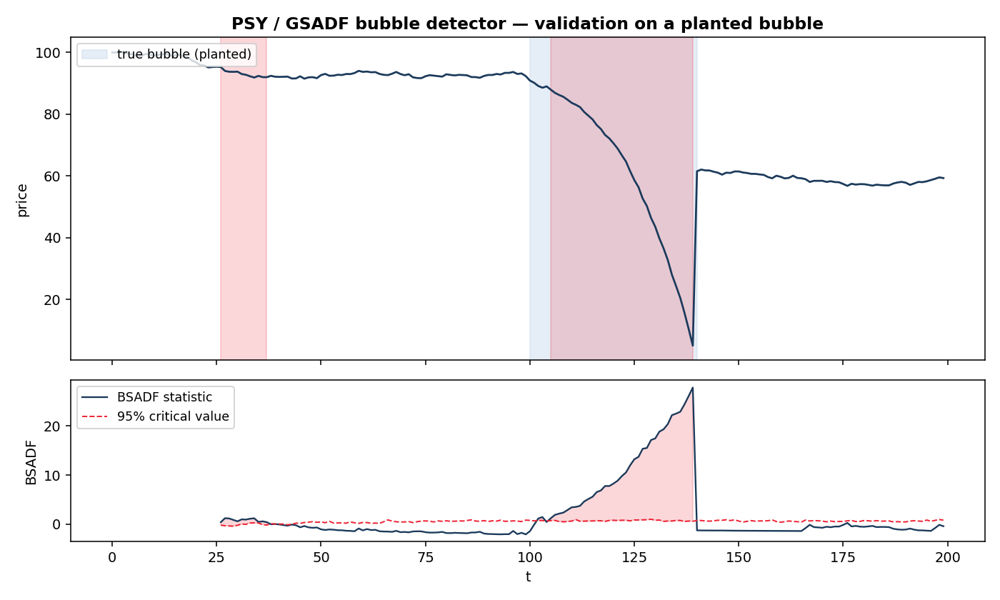

# AI Capital-Cycle Fragility

A statistically rigorous research program for measuring **fragility in the AI / data-center
capital cycle** — the circular flow of money between investors, AI labs, hyperscalers, and
Nvidia that some call a flywheel and others call a bubble.

The project's governing thesis is deliberately modest and therefore defensible: **you cannot
reliably predict the top of a bubble, but you can characterize its fragility** — the regime it
is in and the conditions under which the self-funding loop breaks. Everything here is built to
that standard, with explicit attention to the small-sample and identification problems that
make naïve "bubble prediction" untrustworthy.

## What's here

```
.
├── docs/
│   ├── roadmap.md         # Methodological core (v2): the rigorous research design
│   └── roadmap_v1.md      # Original applied plan (kept for provenance)
├── src/
│   ├── psy_bubble_detector.py   # PSY/GSADF explosive-root bubble detector (from scratch)
│   └── demo_simulated_bubble.py # Self-verifying validation on a planted bubble
└── examples/
    └── bubble_detection_demo.png
```

## The methodology in one paragraph

The "top" is reframed from a *prediction* problem into a **sequential change-point detection**
problem (Shiryaev quickest-detection / CUSUM), which has optimality guarantees and a
characterizable false-alarm vs. delay tradeoff. A "bubble" is given three formal, testable
definitions used in triangulation: an **explosive autoregressive root** (Phillips–Shi–Yu GSADF
test), a **strict local martingale** in the price process (Jarrow–Protter–Shimbo), and a
**rational-bubble cross-equation restriction** (Blanchard–Watson, Tirole). The financing loop
is modeled as a *causal* system (Geanakoplos leverage cycle, Brunnermeier–Pedersen spirals,
Diebold–Yilmaz connectedness, transfer entropy, DebtRank contagion), with early-warning signals
from dynamical-systems theory (critical slowing down) and topology (persistence landscapes).
Everything is wrapped in an anti-overfitting protocol: pre-registration, purged/embargoed
cross-validation, false-discovery-rate control, and an up-front power analysis. See
[`docs/roadmap.md`](docs/roadmap.md) for the full design and references.

## What works today

The **PSY/GSADF detector** ([`src/psy_bubble_detector.py`](src/psy_bubble_detector.py)) is a
from-scratch implementation of the field-standard real-time bubble test — no black-box
dependency. It runs right-tailed ADF regressions over a double-recursive window scheme, takes
the supremum for a whole-sample test, and date-stamps episodes via the backward sup-ADF sequence
against Monte-Carlo-simulated critical values.

**Validation:** the demo plants an explosive bubble of known location in random-walk data and
confirms recovery — true window `t ∈ [100, 140]`, detected `t ∈ [105, 139]`, with the
whole-sample GSADF statistic (27.8) decisively exceeding its 95% critical value (2.34).



## Quickstart

```bash
pip install -r requirements.txt
python src/demo_simulated_bubble.py
```

### On real data

```python
import pandas as pd
from src.psy_bubble_detector import detect_bubbles, episodes

prices = pd.read_csv("nvda.csv", parse_dates=["date"], index_col="date")["close"]
df, summary = detect_bubbles(prices, lags=0, n_sims=999, alpha=0.95, log=True)
print(summary)                 # GSADF stat, critical value, reject flag
print(episodes(df, min_len=5)) # date-stamped explosive episodes
```

## Caveats

- **Detection, not prediction.** The detector flags an *ongoing* explosive regime; it is a
  fragility gauge, not a market-timing signal.
- **False positives are real** and must be controlled (minimum-duration filters, FDR correction,
  confirmation across the other two bubble definitions).
- Critical values are simulation-based and depend on sample size, lag order, and null spec.
- **Not financial advice.** Nothing here should be used as a basis for trading decisions.

## Roadmap (next slices)

1. **Circular-funding-ratio extractor** — externally-sourced revenue ÷ total cash recycled
   through the loop, parsed from SEC EDGAR filings. The project's signature metric.
2. **Quickest-detection monitor** — wrap the detector output into the Shiryaev/CUSUM spine for a
   continuously-updated fragility probability.
3. Strict-local-martingale test; Diebold–Yilmaz connectedness; loop stress-testing.

## License

MIT — see [LICENSE](LICENSE). *(Add your name and year to the license file before publishing.)*

## References

- Phillips, Shi & Yu (2015). *Testing for Multiple Bubbles.* Int. Econ. Review 56(4).
- Jarrow, Protter & Shimbo (2010). *Asset Price Bubbles in Incomplete Markets.* Math. Finance.
- Scheffer et al. (2009). *Early-warning signals for critical transitions.* Nature.
- Gidea & Katz (2018). *Topological data analysis of financial time series.* Physica A.
- Diebold & Yilmaz (2014). *On the network topology of variance decompositions.* J. Econometrics.
