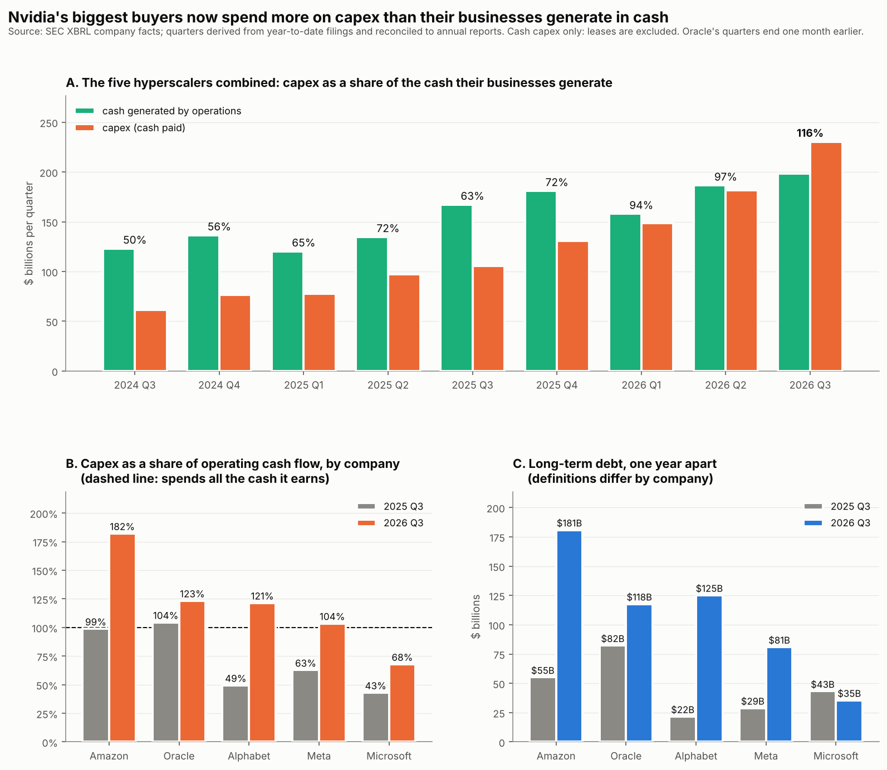
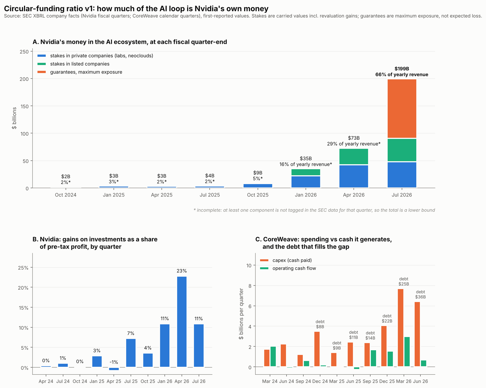
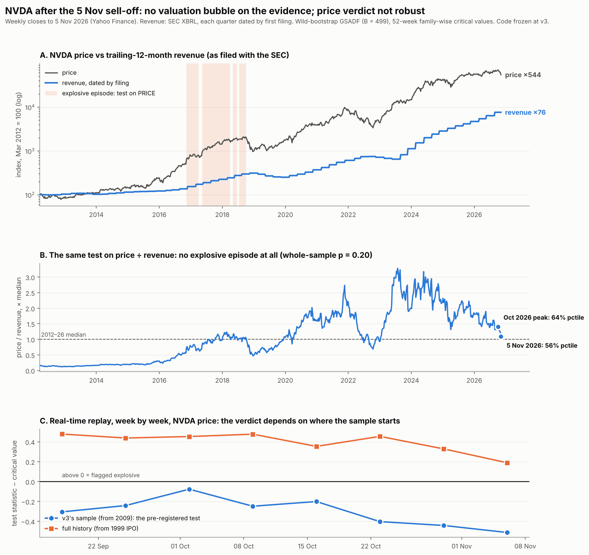

# AI Capital-Cycle Fragility

A statistically careful attempt to measure **fragility in the AI / data-center capital
cycle**: the circular flow of money between investors, AI labs, hyperscalers and Nvidia that
some call a flywheel and others call a bubble.

The governing thesis is deliberately modest: **you cannot reliably predict the top of a
bubble, but you can characterise a regime with a stated error rate.** This repo holds itself
to that, including when it means retracting its own earlier results.

## Latest: the hyperscalers (11 Nov 2026)



- **The five hyperscalers combined now spend more on capex than their businesses generate in
  cash**: $230B against $199B in 2026 Q3 (116%), up from 63% a year earlier and 50% two years ago.
- **Four of five are above 100%** (Amazon 182%, Oracle 123%, Alphabet 121%, Meta 104%);
  Microsoft, at 68%, is the exception. Their combined long-term debt rose from about $231B to
  $540B in a year.
- **Cash is not the immediate constraint**: the five hold about $563B of liquid funds against
  a combined gap of about $30B a quarter, having borrowed ahead. Alphabet and Meta report zero
  buybacks in 2026. Amazon is tightest, at about five quarters. See
  [`results/RESULTS_runway_v1.md`](results/RESULTS_runway_v1.md).
- Demand for Nvidia's chips now leans on credit at every level of the loop. Limits in
  [`results/RESULTS_hyperscalers_v1.md`](results/RESULTS_hyperscalers_v1.md).

## Circular-funding ratio v1 (9 Nov 2026)



- **Nvidia's money in the AI ecosystem rose from ~2% of a year's revenue to 66% in twelve
  months**: $47.9B of private stakes, $42.8B of listed stakes and $108.5B of guarantees
  (maximum exposure) at July 2026, against $303B of trailing revenue.
- **In the April 2026 quarter, 23% of Nvidia's pre-tax profit came from gains on its
  investments**, largely in companies that buy its chips.
- **CoreWeave funds about three-quarters of its build-out with outside money**; debt quadrupled
  in 18 months to $35.6B and interest takes about a fifth of revenue every quarter.
- An upper bound, not proof the revenue is fake; limits and next steps in
  [`results/RESULTS_circular_v1.md`](results/RESULTS_circular_v1.md).

## Current status (v3.1, 6 Nov 2026 — the day after the AI sell-off)



- **Pre-registered out-of-sample test passed.** Before running it, we predicted that v3, code
  frozen, would date no explosive NVDA episode through October 2026. Replayed week by week
  from 18 Sep to 5 Nov, it never flagged one, and it stayed silent through a 24% fall from the
  October peak, as designed.
- **Nvidia shows no valuation bubble on the evidence.** Tested on price ÷ trailing revenue
  (SEC filings, dated by filing), there is no explosive episode since 2012 (p = 0.20); the
  same test on price over the same window finds the 2016–18 episode (p = 0.068). At its
  October 2026 peak, NVDA's price/sales was at the 64th percentile of its 2012–26 range, and
  the multiple has been falling for two years.
- **The price-only verdict is not robust.** Starting the sample at Nvidia's 1999 IPO instead of
  2009 flips "not explosive" to "explosive since April 2026". Equal-weight S&P (RSP) shows
  nothing on either sample: whatever is explosive is concentrated, not market-wide.
- **Next is the revenue itself.** The ratio test takes revenue as given. If some of it is
  financed by Nvidia's own investments in its customers, a bubble would sit in the denominator,
  which is what the circular-funding ratio is for.

Full write-up: [`results/RESULTS_v31.md`](results/RESULTS_v31.md). Earlier: v3 results in
[`results/RESULTS_v3.md`](results/RESULTS_v3.md); why v2 was withdrawn in
[`docs/REFEREE_REPORT_v2.md`](docs/REFEREE_REPORT_v2.md).

## Method in one paragraph

A bubble is operationalised as a **mildly explosive autoregressive root in log valuation**,
tested with the Phillips–Shi–Yu GSADF procedure (implemented from scratch; the prefix-sum
version is validated against the reference to 1e-14). Critical values come from an
**order-preserving wild bootstrap**, so the null carries the sample's own volatility path
(Harvey et al. 2016). Episodes are dated against **family-wise critical values** that control
false flags per 52-week window (Phillips & Shi 2020), with PSY's ⌈log T⌉ minimum duration.
Across series, Benjamini–Hochberg FDR. Each dated episode is evaluated on what someone relying
on it would have lived through: gain after detection, loss before the test says "over", and
what came next. Every bubble test is also a test of a fundamentals model (Fama's
joint-hypothesis problem), so conclusions are meant to be reported across a ladder of them:
price → price/sales → price/earnings. The broader research design (circular-funding ratio,
leverage-cycle stress tests) is in [`docs/roadmap.md`](docs/roadmap.md), with a Sep 2026 update
in [`docs/roadmap_addendum_2026-09.md`](docs/roadmap_addendum_2026-09.md).

## Reproduce

```bash
pip install -r requirements.txt
pytest -q                                  # 23 tests, ~1 min: every simulation claim above

# real data (Yahoo prices, SEC revenue, FRED macro) into ./data, on your own machine:
python src/fetch_data.py --sec-contact "Your Name you@example.com"
python src/oos_realtime.py                 # v3.1 real-time replay -> results/oos_realtime.csv
python src/nvda_valuation.py               # v3.1 price-to-revenue test
python src/make_figure_v31.py              # -> results/v31_nov2026.png
python src/circular_funding.py             # circular-funding ratio v1 -> results/circular_*.csv
python src/make_figure_circular.py         # -> results/circular_v1.png
python src/run_v3.py                       # tests, FDR, episodes  -> results/*.csv   (~3 min)
python src/size_study.py 400               # false-positive study  -> results/size_study.csv
python src/boom_vs_bubble.py 300           # boom vs bubble        -> results/boom_vs_bubble.csv
python src/make_figure_v3.py               # -> results/v3_summary.png
```

Run from the repo root. `data/` is git-ignored; result tables in `results/` are committed.

## Layout

```
src/
  psy_bubble_detector.py   reference GSADF implementation (v1; slow, used as ground truth in tests)
  fast_psy.py              prefix-sum BSADF, ~1000x faster, validated against the reference
  psy_v3.py                wild bootstrap, family-wise dating, episode evaluation, BH-FDR
  fundamentals.py          boom-vs-bubble simulation; look-ahead-free valuation ratios
  run_v3.py, size_study.py, boom_vs_bubble.py, make_figure_v3.py
  fetch_data.py            downloads prices (Yahoo), revenue (SEC), macro (FRED) into data/
  oos_realtime.py          v3.1 week-by-week real-time replay, frozen v3 code
  nvda_valuation.py        v3.1 price-to-revenue test, same-window control, decomposition
  make_figure_v31.py
  circular_funding.py      circular-funding ratio v1 from SEC company facts (self-reconciling)
  make_figure_circular.py
  hyperscalers.py          hyperscaler capex vs operating cash flow and debt
  make_figure_hyperscalers.py
  runway.py                how long each hyperscaler can fund its gap from cash on hand
  legacy_v2_cusum_monitor.py   withdrawn; kept for provenance
tests/                     the claims, as tests (test_v3.py, test_valuation.py, test_circular.py)
results/                   RESULTS_v3.md, tables, figure
docs/                      roadmap, Sep-2026 addendum, referee report on v2
```

## Next

1. **Circular-funding ratio v2**: add the filing text (who the stakes and guarantees are in,
   customer concentration), the hyperscalers' capex vs cash flow, and Nvidia's October quarter.
2. **Replicate PSY (2015)** on Shiller's S&P 500 price–dividend data. Recovering their published
   dot-com dates is the strongest external validation available.
3. Add P/E alongside P/S, and the hyperscalers and neoclouds, to the valuation ladder.

## Caveats

Detection characterises a regime; it does not time anything. Section 3 of the results shows
the price rising 20–178% *after* detection. Nothing here is investment advice.

## License

MIT — see [LICENSE](LICENSE).

## References

- Phillips, Shi & Yu (2015). Testing for multiple bubbles. *International Economic Review* 56(4).
- Phillips & Shi (2020). Real time monitoring of asset markets: bubbles and crises. *Handbook of Statistics* 42.
- Harvey, Leybourne, Sollis & Taylor (2016). Tests for explosive financial bubbles in the presence of non-stationary volatility. *Journal of Empirical Finance* 38.
- Giacomini, Politis & White (2013). A warp-speed method for conducting Monte Carlo experiments involving bootstrap estimators. *Econometric Theory* 29(3).
- Fama (1970). Efficient capital markets: a review of theory and empirical work. *Journal of Finance* 25(2).
