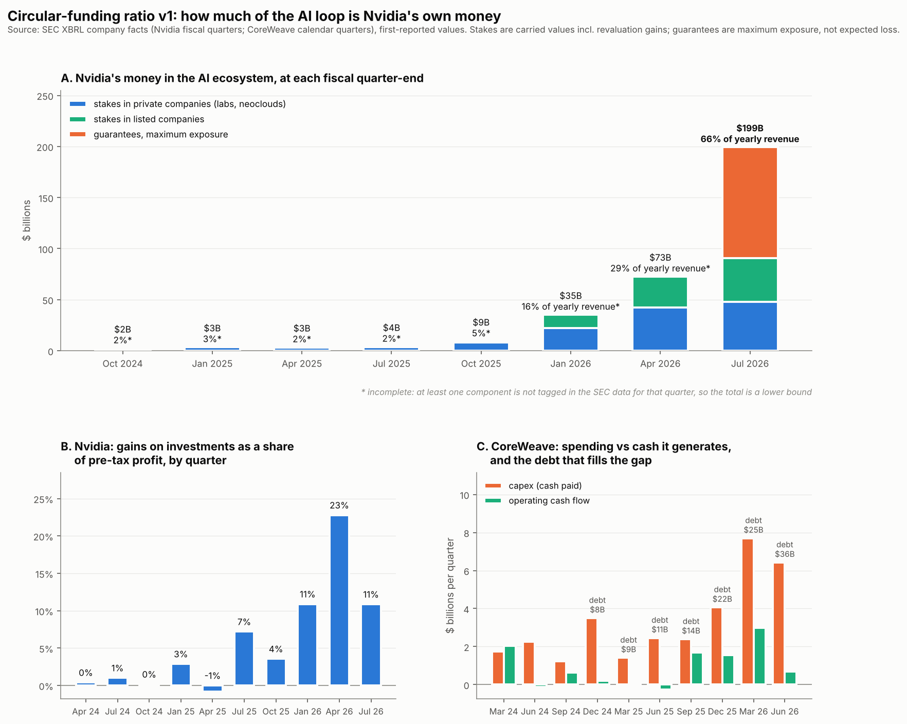

# Circular-funding ratio v1 — 9 November 2026

> **Corrections, 13 Nov 2026** (from the filing notes; see `RESULTS_filing_notes_v1.md`):
> (1) $105B of the $108.5B guarantees was signed in August 2026, after the quarter, and
> does not take effect until leases start from fiscal 2029; only $3.5B was live at July 2026.
> On deployed money the exposure is about 33% of trailing revenue, not 66%.
> (2) New money into private stakes in the July 2026 quarter was $13.1B, not $0.7B.

**Question.** The v3.1 result found no bubble in Nvidia's price *relative to its revenue*.
That moves the question to the revenue itself: how much of the AI capital loop is Nvidia's
own money coming back?

**Data.** SEC XBRL company facts for Nvidia and CoreWeave, downloaded 9 Nov 2026
(`src/fetch_data.py`). Values are as first reported. Every quarterly flow is derived from
year-to-date filings and **reconciled to the annual 10-K totals on every run**
(`circular_funding.reconcile`); all series used pass, to the dollar. Code:
`src/circular_funding.py`; tests: `tests/test_circular.py`.



## 1. Nvidia's money in the AI ecosystem

At each fiscal quarter-end, in $ billions. "n/t" = not tagged in this form, never zero.

| quarter end | stakes, private cos. | stakes, listed cos. | guarantees (max exposure) | total | % of trailing-12m revenue |
|---|---|---|---|---|---|
| Jul 2025 | 3.8 | n/t | n/t | 3.8 | 2%* |
| Oct 2025 | 8.2 | n/t | 0.9 | 9.1 | 5%* |
| Jan 2026 | 22.3 | 12.9 | n/t | 35.2 | 16%* |
| Apr 2026 | 42.3 | 30.2 | n/t | 72.5 | 29%* |
| **Jul 2026** | **47.9** | **42.8** | **108.5** | **199.2** | **66%** |

\* incomplete row (a component not tagged), so a lower bound.

**In twelve months, Nvidia's money sitting in the AI ecosystem went from about 2% of a year's
revenue to 66%.** Stakes alone are $90.7B, 30% of a year's revenue. The biggest single item
is the guarantee line, which jumped from $0.9B to $108.5B in nine months; that is consistent
with press reports of a ~$105B guarantee to OpenAI, but the company-facts data does not say
whom the guarantees cover.

Also tagged: unconditional purchase commitments kept off the balance sheet rose from $7.6B
(Jan 2025) to $22.7B (Jan 2026).

**How much was new cash, not revaluation?** Private stakes rose by $44.1B between Jul 2025 and
Jul 2026. Nvidia booked $9.5B of upward revaluations on them over the same four quarters, so
roughly $34.6B was new money. Quarter by quarter (change in private stakes minus revaluation):
$3.6B, $12.8B, $17.5B, then just $0.7B in the July quarter, when listed stakes rose $12.5B,
possibly as private holdings moved to listed. The data cannot separate transfers from purchases.

## 2. The loop in Nvidia's profits

Gains on investments as a share of Nvidia's pre-tax profit, by quarter:

| Jul 2024 | Jan 2025 | Jul 2025 | Oct 2025 | Jan 2026 | **Apr 2026** | Jul 2026 |
|---|---|---|---|---|---|---|
| 1% | 3% | 7% | 4% | 11% | **23%** | 11% |

In the April 2026 quarter, **$15.9B of Nvidia's $69.9B pre-tax profit came from gains on its
investments**, largely stakes in companies that buy its chips. Those gains are real accounting
profit, but they depend on the valuations of the loop's own participants.

## 3. CoreWeave: the borrowing side

| quarter | revenue | capex (cash paid) | operating cash flow | capex funded externally | debt | interest ÷ revenue | backlog |
|---|---|---|---|---|---|---|---|
| Dec 2024 | 0.7 | 3.5 | 0.2 | 95% | 8.0 | 19% | n/t |
| Jun 2025 | 1.2 | 2.5 | −0.3 | 110% | 11.2 | 21% | 30.1 |
| Dec 2025 | 1.6 | 4.1 | 1.6 | 62% | 21.6 | 22% | 60.7 |
| Mar 2026 | 2.1 | 7.7 | 3.0 | 61% | 25.1 | 21% | 98.8 |
| **Jun 2026** | **2.6** | **6.4** | **0.7** | **89%** | **35.6** | **22%** | **103.7** |

In the first half of 2026, CoreWeave paid $14.1B for equipment and generated $3.7B from
operations: **about three-quarters of its build-out is funded by outside money**, and debt
quadrupled in 18 months to $35.6B. **Interest costs take about a fifth of revenue, every
quarter.** The backlog ($103.7B) is what lenders are lending against. Equipment is also being
acquired on credit (press reports put CoreWeave's total Q2 2026 capex at about $9.4B against the
$6.4B of cash paid), so the external share above is conservative.

## 4. What this means for the bubble question

v3.1 said Nvidia's price is in line with its revenue. This says **the foundation under that
revenue changed fast in the last year**: Nvidia now has a sum equal to two-thirds of a year's
revenue riding on the ecosystem that buys its chips, a fifth of one quarter's profit came from
marking up stakes in that ecosystem, and its most leveraged customer funds most of its
spending with debt costing a fifth of its revenue.

That is not proof the revenue is fake. Much of Nvidia's revenue comes from hyperscalers that
still fund most of their spending from their own cash flow, and an investment in a customer does not mean the customer spends it
on Nvidia. It means the loop's internal share is no longer small, so the revenue question is
now a live one rather than a footnote.

## 5. Limits

- **Upper bound, not a measured share of revenue.** Not every investee is a customer (the
  listed stakes likely include Nvidia's 2025 Intel investment, a partner rather than a buyer), and filings do not trace dollars
  from investment to purchase.
- **Stakes are carried values** and include revaluation gains; **guarantees are maximum
  exposure**, not expected losses.
- **Not in the company-facts data:** customer concentration, stakes by investee, what the
  guarantees and purchase commitments cover, and Nvidia's custom-tagged cash-flow line for
  private investments. These need the filing text (the next step).
- Nvidia's fiscal quarters end about a month after CoreWeave's calendar quarters; the two
  panels are not aligned month by month.
- Nothing here is investment advice.

## 6. Next

1. **Nvidia's Q3 FY2027 10-Q** (results 17 Nov, filing shortly after) adds the October 2026
   quarter: re-run `fetch_data.py` and this script, and the first post-sell-off data point
   arrives.
2. **Filing-text layer:** read the notes on investments, guarantees and commitments to split
   exposure by counterparty, and get customer concentration.
3. **Hyperscalers:** the same capex-vs-cash-flow test for Microsoft, Alphabet, Amazon, Meta and
   Oracle, which this same company-facts route supports directly.

## Reproduce

```bash
python src/fetch_data.py --sec-contact "Your Name you@example.com"
python src/circular_funding.py        # reconciles every series, writes results/circular_*.csv
python src/make_figure_circular.py    # -> results/circular_v1.png
pytest -q                             # 20 tests
```
