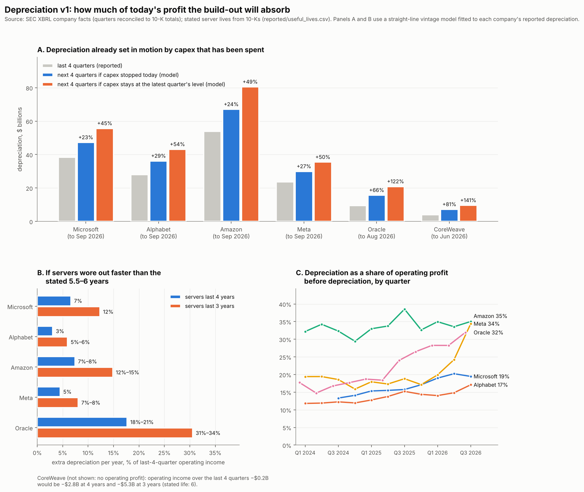

# Depreciation v1: are the earnings real? (21 November 2026)

**Question.** The thesis is that the AI build-out breaks when earnings and credit run out of
steam, not when rates rise. Every dollar of capex comes back later as depreciation, a cost that
reduces operating profit. Companies choose how many years to spread a server's cost over (its
"useful life"). Longer lives mean smaller yearly charges and higher reported profit. So:

1. How much depreciation is already locked in by capex that has been spent?
2. How much of today's profit depends on the stated server lives?

**Data.** SEC XBRL company facts (downloaded 9 Nov 2026). Quarterly depreciation and operating
income are derived from year-to-date filings and reconciled to the 10-K annual totals on every
run. Stated server lives come from the 10-Ks: Oracle's read directly on sec.gov, the others as
quoted by two secondary write-ups (`reported/useful_lives.csv`, each row with its source and
grade). Code: `src/depreciation.py`, figure `src/make_figure_depreciation.py`, tests
`tests/test_depreciation.py` (6).



## Stated server lives

| company | life used | latest change, as stated | stated effect |
|---|---|---|---|
| Microsoft | 6 | "two to six years"; no change stated | — |
| Alphabet | 6 | "generally over six years"; no change stated | — |
| Amazon | 6 | a subset cut from six to five years, 1 Jan 2025, citing the pace of AI development | 2025: +$1.4B depreciation, −$1.0B net income |
| Meta | 5.5 | most servers extended to 5.5 years, 1 Jan 2025 | 2025: −$2.92B depreciation, +$2.59B net income |
| Oracle | 6 | six years; no change disclosed (10-K, May 2026) | — |
| CoreWeave | 6 | extended from five to six years, 1 Jan 2023 | 2023: −$20M expenses |

The two 2025 changes went in opposite directions: Amazon shortened, Meta lengthened.

## Method

There is no public breakdown of how much of each company's capex is servers (short-lived) and
how much is buildings and land (long-lived). So the model infers it. Each quarter's capex is
split into a short-lived share *s*, depreciated straight-line over the stated server life, and a
long-lived remainder, depreciated over 20 years. Depreciation starts a set number of quarters
(the lag, 0–2) after the cash is paid. For each lag, *s* is fitted by least squares to the
company's reported depreciation since its latest life change (7–9 quarters; 6 for CoreWeave).
Results are shown for every lag that fits within 10% RMSE.

The fits are tight at the best lag: RMSE 1.9% (Amazon) to 7.2% (Microsoft). CoreWeave fits only
at lag 0. For CoreWeave the additions are the change in gross property and equipment, because
much of its equipment is bought on credit and doesn't appear in cash capex.

**What the data can and cannot pin down.** *s* and the lag trade off: a longer lag with a bigger
*s* fits almost as well, so neither is identified on its own. The two answers below sit
differently on that trade-off:
- **The useful-life sensitivity is pinned down.** It barely moves across lags (Microsoft 7% at
  every lag).
- **The "capex stops" projection is not.** It spans a range, so it is reported as a range.

**One independent check.** Oracle's 10-K gives its server cost directly: $30.3B gross at May 2025
and $59.6B at May 2026. At six years on the average, that is $7.5B of depreciation, 98% of the
$7.6B Oracle actually booked in that fiscal year. The model puts the server share at 83% at its
best-fitting lag and 95% at a one-quarter lag. So for Oracle, the upper end of each range below is
the better guide.

## 1. Depreciation already set in motion

| | last 4 quarters | next 4 if capex stopped today | next 4 if capex stays at the latest quarter |
|---|---|---|---|
| Microsoft | $38.3B | $47.3B (+23% to +33%) | $55.7B (+45% to +46%) |
| Alphabet | $28.0B | $36.2B (+29% to +40%) | $43.1B (+45% to +54%) |
| Amazon | $54.0B | $67.1B (+24% to +38%) | $80.5B (+43% to +49%) |
| Meta | $23.6B | $29.9B (+27% to +41%) | $35.5B (+45% to +50%) |
| Oracle | $9.4B | $15.7B (+66% to +92%) | $20.9B (+122% to +126%) |
| CoreWeave | $4.0B | $7.2B (+81%) | $9.6B (+141%) |

Dollar figures are at the best-fitting lag. Ranges cover every lag that fits.

**Over the last year, the five hyperscalers' depreciation rose $49B (+47%) and their operating
income rose $91B (+21%).** If capex merely stays at the latest quarter's level, with no further increase,
depreciation rises another **$82B** over the next four quarters. That is 16% of their current operating income, and almost all of last year's profit
growth.

Even if every company stopped spending today, depreciation at the four largest would still rise
23% to 41% from spending already done.

Depreciation is already growing faster than operating income at every company:

| last 4 quarters vs the 4 before | depreciation | operating income |
|---|---|---|
| Microsoft | +57% | +20% |
| Alphabet | +45% | +27% |
| Amazon | +40% | +37% |
| Meta | +37% | −3% |
| Oracle | +114% | +28% |
| CoreWeave | +146% | loss in the latest 4 quarters |

Depreciation's share of operating profit before depreciation (panel C):
- **Meta**: doubled in three quarters, from 17% (Dec 2025) to 34% (Sep 2026). Its operating
  income fell to $13.0B in the September quarter from $20.5B a year earlier.
- **Oracle**: rose from 26% to 32%.
- **Microsoft and Alphabet**: near 20% and rising.
- **Amazon**: steady around 35%.

## 2. How much of the profit depends on the stated lives

This is extra depreciation per year if servers lasted fewer years than stated, applied to the
current fleet.

| | at 4 years | at 3 years |
|---|---|---|
| Microsoft | $10.8B, 7% of operating income | $20.1B, 12% |
| Alphabet | $4.8B, 3% | $9.4B, 5–6% |
| Amazon | $7.7B, 7–8% | $15.5B, 12–15% |
| Meta | $3.6B, 5% | $6.4B, 7–8% |
| **Oracle** | **$4.1B, 18–21%** | **$7.0B, 31–34%** |
| **CoreWeave** | operating income −$0.2B → **−$2.8B** | → **−$5.3B** |

**For the four largest, the accounting choice is not what holds profits up.** Even a three-year
life would take 5–15% off operating income. **The exposure sits at the leveraged end of the
chain.** At Oracle a four-year life would remove about a fifth of operating profit. CoreWeave
has no operating profit to absorb it, and a four-year life would put it about $2.8B a year into
the red. These are the same two companies the rate-stress result flagged.

**Is a six-year life wrong?** Not on current evidence. H100s, first shipped in 2022, still rent
for about $3.30–3.52 per GPU-hour (Oct–Nov 2026 readings in `reported/watchlist_readings.csv`,
secondary source), and the rate rose between the two readings. The test is whether older chips keep earning
as new generations arrive each year. Watch-list light T3 (GPU rental prices) already tracks
exactly that. If T3 trips, section 2 is the size of the hit to reported profit.

## 3. What this means for the bubble question

The earnings are real in the sense that matters: the hyperscalers' profits are not an artefact
of generous depreciation schedules. **The risk is timing.** Depreciation from spending already
done grows on a fixed schedule whether or not AI revenue keeps up. On the current spending path,
next year's depreciation increase roughly equals all of last year's profit growth. So revenue has
to keep growing at least as fast as it did last year for operating income merely to stand still.

That makes this the mechanism behind "earnings run out of steam":
- If AI revenue growth slows for a few quarters, depreciation keeps compounding and margins
  compress mechanically. No write-down is needed.
- Meta's September quarter shows how quickly that can appear: operating income down 37% year
  on year while depreciation rose 43%.
- Where the asset-life assumption is also doubtful (Oracle, CoreWeave), the squeeze and a
  possible life cut would arrive together.

## 4. Limits

- **A model, not a disclosure.** Except for Oracle, the server share is inferred from the
  depreciation history, not observed.
- **The "capex stops" projection** depends on the lag between paying for equipment and it going
  into service, which the data cannot pin down. Hence the ranges.
- **Cash capex excludes finance leases**, which are large at Microsoft and Amazon. So *s* is per
  dollar of cash capex, not a physical share.
- **Asset disposals are ignored.** Amazon runs a subset of servers at five years but the model
  uses six for all, which slightly overstates its sensitivity in section 2.
- **Shorter lives are a counterfactual on the accounting**, not a forecast that any company will
  change its estimate.
- **Operating income includes non-AI businesses** (advertising, Office, retail), which carry most
  of the profit at Alphabet, Meta and Amazon.
- **Quarters differ by company.** Oracle's latest quarter ends in August, CoreWeave's in June.
- **Meta's reconciliation tolerance is $25M.** Its quarterly depreciation is presented rounded to
  $10M, and its quarters differ from the 10-K totals by exactly $10M in FY2023 and FY2024.
- Nothing here is investment advice.

## 5. Next

1. Re-run after the next filings (Oracle mid-December; the others late January to early
   February) and check the "capex flat" projection against what is actually reported. That is
   the model's first out-of-sample test.
2. Candidate warning light for a dated watch-list v1.1: combined hyperscaler operating income
   falling year on year while depreciation still rises. Set it before the January results if
   wanted.
3. Read the server and network line of property and equipment from the other five 10-Ks (as was
   done for Oracle). That replaces the inferred share with the disclosed one.

## Reproduce

```bash
python src/fetch_data.py --sec-contact "Your Name you@example.com"
python src/depreciation.py              # reconciles, fits, writes results/depreciation_*.csv
python src/make_figure_depreciation.py  # -> results/depreciation_v1.png
pytest -q
```
