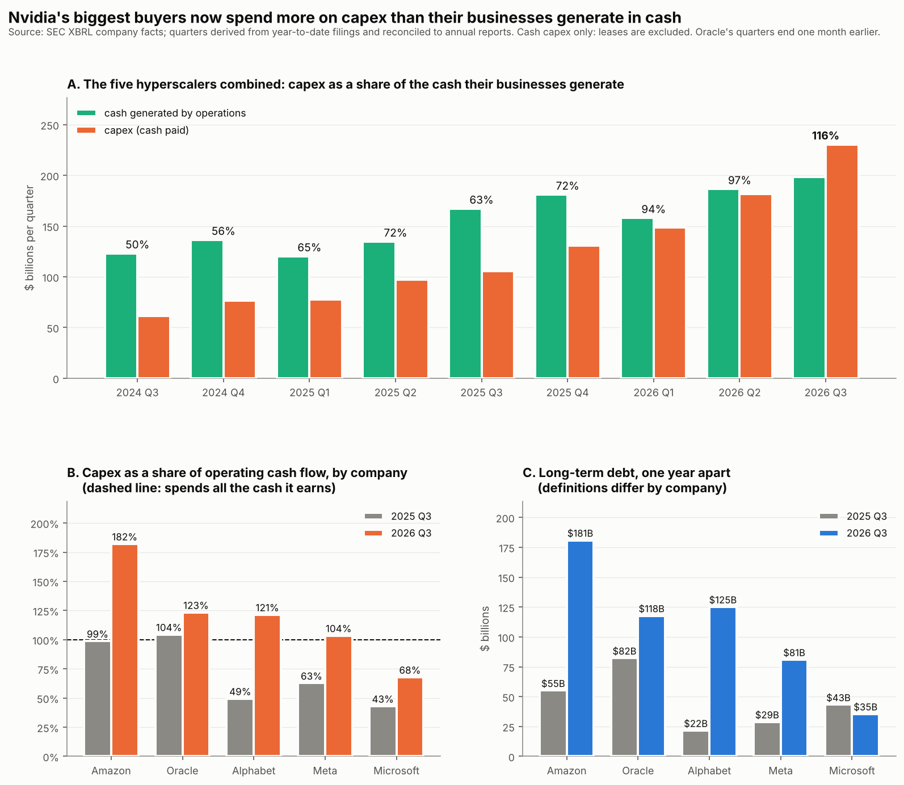

# Circular-funding ratio v2, part 1: the hyperscalers — 11 November 2026

**Question.** Version 1 showed the loop between Nvidia, the AI labs and the neoclouds.
The reassurance at the time was that most of Nvidia's revenue comes from hyperscalers
paying out of their own cash flow. This tests that.

**Data.** SEC XBRL company facts for Microsoft, Alphabet, Amazon, Meta and Oracle,
downloaded 11 Nov 2026. Quarterly figures are derived from year-to-date filings and
reconciled to every annual report in the window on each run. Code: `src/hyperscalers.py`.



## 1. Combined: capex now exceeds operating cash flow

| calendar quarter | capex ($B) | operating cash flow ($B) | capex ÷ cash flow |
|---|---|---|---|
| 2024 Q3 | 61 | 123 | 50% |
| 2025 Q3 | 106 | 167 | 63% |
| 2026 Q1 | 148 | 158 | 94% |
| 2026 Q2 | 182 | 186 | 97% |
| **2026 Q3** | **230** | **199** | **116%** |

In the latest quarter the five spent **$32B more on capex than their businesses generated
in cash**. Capex more than doubled in a year (×2.2) while operating cash flow grew 19%.
Two years ago capex took half of cash flow.

## 2. By company (2026 Q3, with 2025 Q3 for comparison)

| | capex ÷ cash flow, 2025 Q3 | 2026 Q3 | long-term debt, 2025 Q3 ($B) | 2026 Q3 ($B) |
|---|---|---|---|---|
| Amazon | 99% | **182%** | 55 | 181 |
| Oracle | 104% | **123%** | 82 | 118 |
| Alphabet | 49% | **121%** | 22 | 125 |
| Meta | 63% | **104%** | 29 | 81 |
| Microsoft | 43% | 68% | 43 | 35 |

Four of the five now spend more than they earn in cash. **Microsoft is the exception**: it
still covers capex comfortably and its debt fell. Combined long-term debt went from about
**$231B to $540B in one year**.

## 3. What this means for the loop

Version 1's caveat no longer holds as written. Nvidia's biggest buyers are, as a group, no
longer funding the build-out from their own cash; the gap is being filled with debt. That
does not make the spending unsound: these companies have large cash balances, strong credit
and real businesses, and borrowing to build is normal. It does mean **the demand for
Nvidia's chips now depends on credit markets staying open at every level**: the neoclouds,
the labs, and now four of the five hyperscalers. That is a wider base of fragility than
version 1 showed, and it is the same dependence the September rate hike and the November
sell-off put under pressure.

## 4. Limits

- **Cash capex only.** Finance leases and leases signed but not yet started are not
  included, so true commitments are higher than shown.
- **Debt definitions differ by company** (the tags available differ), so compare each
  company with its own past, not with the others.
- Cash on hand, buybacks and dividends are not netted here; a company can exceed 100% for a
  time by drawing down cash.
- Oracle's fiscal quarters end a month before the others'; quarter-to-quarter swings in
  operating cash flow are partly seasonal, so the trend matters more than any one quarter.
- Not all hyperscaler capex goes to Nvidia: it also covers buildings, power, networking and
  in-house chips.
- Nothing here is investment advice.

## Reproduce

```bash
python src/fetch_data.py --sec-contact "Your Name you@example.com"
python src/hyperscalers.py                # -> results/hyperscalers.csv
python src/make_figure_hyperscalers.py    # -> results/hyperscalers_v1.png
```
