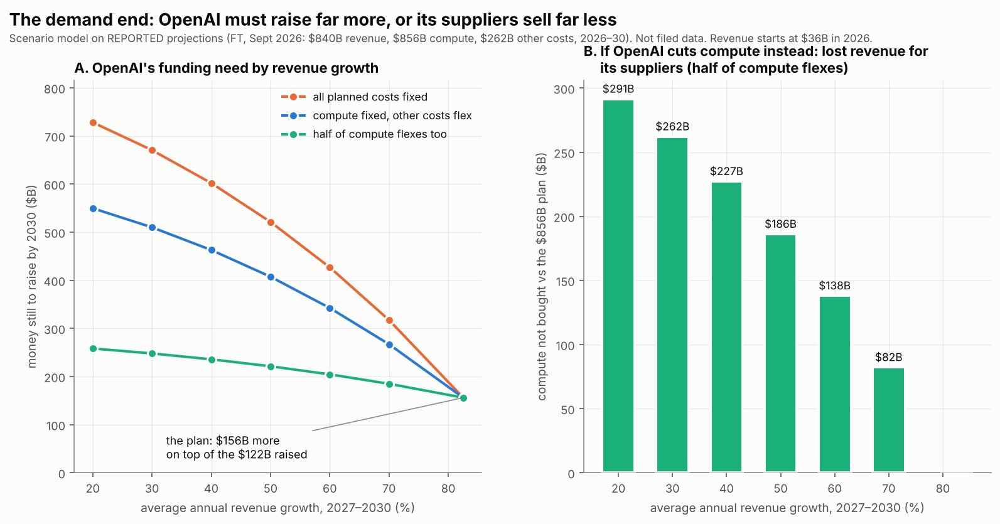

# The demand end, part 1: OpenAI's funding gap — 17 November 2026

**Question.** Nvidia, the hyperscalers and the neoclouds are building for demand that
ultimately comes from the AI labs. Can the largest of them pay for what it has planned?

**Data grade: reported, not filed.** OpenAI is private. Every input is a reported figure
(leaked projections and press reports), recorded with its source and date in
`reported/openai.csv` and kept apart from SEC data. The headline projections come from an
OpenAI presentation seen by the Financial Times (18 Sept 2026); OpenAI did not comment.
Actual 2026 figures are Wall Street Journal reports relayed by a secondary tracker. This is a
scenario model, not a measurement. Code: `src/labs.py`; tests: `tests/test_labs.py`.

*Disclosure: this analysis was written with Claude, made by Anthropic, a competitor of OpenAI
that sits in the same financing loop. The same model will be applied to Anthropic.*

## 1. The plan, as reported (2026–2030)

| | $ billions |
|---|---|
| Revenue | 840 (from 36 in 2026 to 350 in 2030) |
| Compute and infrastructure | 856 |
| Other costs | 262 |
| Free cash flow | **−278** (an earlier plan in May: −305) |
| Raised in March 2026 | 122 (reportedly used up in 2028) |

The totals agree with each other to the dollar (840 − 856 − 262 = −278); the model checks this
before running. **Compute alone costs more than all the revenue the plan expects.** Even on
plan, **$156B more must be raised** on top of the $122B.

Only five-year totals were reported, so the model works on totals and does not invent a
year-by-year path. A constant growth rate that matches the plan's $840B is 83% a year, which
would reach $400B by 2030, above the plan's $350B: the plan assumes growth is fastest early.

## 2. Scenarios: what if revenue grows more slowly?

Revenue starts at $36B in 2026 and grows at a constant rate through 2030. Three cases for how
much of the planned spending could be cut if revenue falls short:

| growth 2027–30 | 2030 revenue | 5-year revenue | to raise: all costs fixed | compute fixed, other flexes | half of compute flexes | compute not bought (last case) |
|---|---|---|---|---|---|---|
| 30% | $103B | $326B | $670B | $510B | $248B | $262B |
| 50% | $182B | $475B | $521B | $407B | $221B | $186B |
| 70% | $301B | $679B | $317B | $267B | $185B | $82B |
| plan (~83%) | $400B | $840B | $156B | $156B | $156B | $0 |

**Reading it.** Every row needs well over $100B of new money. If revenue grows 50% a year,
which would still be extraordinary, OpenAI either raises about $520B more (if it keeps every
compute contract) or cuts compute and its suppliers sell about $186B less than planned. In
practice it would be some of each. Either the money comes from investors, or the shortfall
lands on Oracle, CoreWeave, Microsoft and, through them, Nvidia.

**Scale.** The plan's compute spend averages about $171B a year, roughly a fifth of the five
hyperscalers' current capex pace (about $920B a year, from 2026 Q3).

## 3. A near-term checkpoint

OpenAI's reported revenue was $5.7B in Q1 2026 and $6.7B in Q2: $12.4B for the half-year.
The plan's $36B for 2026 needs **$23.6B in the second half, 1.9× the first**. A run-rate of
about $50B a year was reported at the end of September (about $12.5B a quarter), which would
make the target reachable, but run-rate reports have conflicted (estimates for July ranged
from $30B to over $40B). OpenAI's 2026 revenue, when reported, is the first test of the plan.
Over the same half-year it reported operating losses of $21.6B.

## 4. What this adds to the project

The earlier work found the suppliers in good shape (Nvidia's price fits its revenue) and the
hyperscalers borrowing but pre-funded. This finds the weakest point: the end buyer's plan
requires near-uninterrupted access to new capital on a scale of hundreds of billions,
regardless of how revenue turns out. The loop's fragility is less about whether AI demand is
real and more about whether its financing can keep pace with its contracts.

## 5. Limits

- Reported projections from a single leaked presentation; actuals are secondhand reports.
- Constant growth is a simplification; the plan itself front-loads growth.
- Which costs can actually be cut depends on contract terms that are not public.
- Excludes revenue sharing with Microsoft, new business lines and any change to the plan.
- Nothing here is investment advice.

## Next

1. The same model for Anthropic, and for xAI where figures exist.
2. The transmission into filed data: how much of Oracle's and CoreWeave's contracted backlog
   depends on OpenAI.

## Sources

- [OpenAI forecasts cash burn near $280 billion by 2030, FT reports — Reuters via Investing.com](https://www.investing.com/news/economy-news/openai-expects-to-burn-through-almost-280-billion-by-2030-ft-reports-4907970) (18 Sep 2026)
- [OpenAI projections point to a massive $278 billion cash burn through 2030 — Tom's Hardware via Yahoo Finance](https://finance.yahoo.com/technology/ai/articles/openai-projections-point-massive-278-120000345.html) (21 Sep 2026)
- [OpenAI revenue, losses and cash burn: what has been reported — safeguard.sh](https://safeguard.sh/resources/blog/openai-revenue-losses-and-cash-burn-what-has-been-reported) (secondary tracker of WSJ, FT, Fortune reports)
