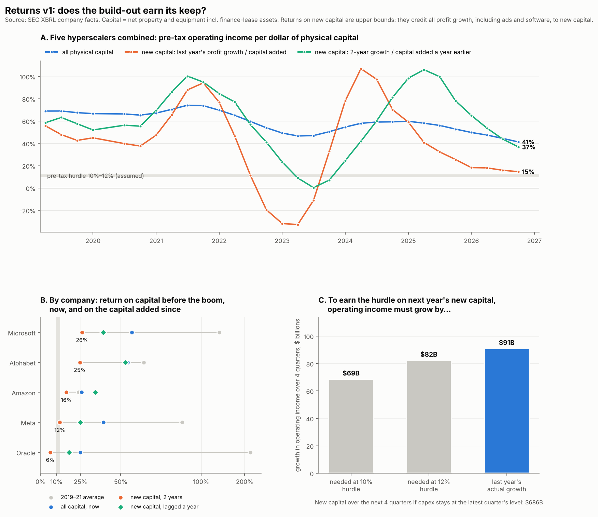

# Returns v1: does the build-out earn its keep? (24 November 2026)

**Question.** Depreciation v1 showed the costs of the build-out arriving on a fixed schedule.
This asks the other half: how much profit does each dollar of physical capital produce, and
how much does each **new** dollar produce? In a capex boom that ends badly, the return on new
capital falls toward, then below, the cost of capital while spending keeps rising. That is the
measurable form of "the earnings run out of steam".

**Data.** SEC XBRL company facts (downloaded 9 Nov 2026). Operating income is derived quarterly
and reconciled to the 10-K totals. Capital is net property and equipment including
finance-lease assets, at each quarter-end. Code: `src/returns.py`, figure
`src/make_figure_returns.py`, tests `tests/test_returns.py` (4).



## Definitions, and how to read them

- **Return on capital**: operating income over the last 4 quarters ÷ average capital over the
  same period. Pre-tax, to avoid one-off tax items (Meta's 2025 tax charge, for example).
- **Return on new capital**: the change in 4-quarter operating income ÷ the change in capital.
  It is measured over one year, over two years, and over two years with capital lagged one year,
  because new data centres take time to start earning.
- **Hurdle**: a pre-tax return of **10–12%**, which is an 8–10% cost of capital grossed up for
  tax. This is an **assumption**, not an estimate, and is shown as a band.

**The key caveat.** Operating income also grows for reasons that need little new equipment
(ad pricing, software). Return on new capital credits all of that growth to the new capital, so
it is an **upper bound** on what the new, mostly AI, capital earns. A falling number is
informative. A high number does not prove the AI capital pays.

## 1. The five hyperscalers combined

| calendar quarter | operating income, 4q | capital | return on capital | on new capital, 1 year | 2 years | 2 years, capital lagged |
|---|---|---|---|---|---|---|
| 2021 Q3 | $237B | $367B | 74% | 94% | 68% | 95% |
| 2022 Q3 | $221B | $449B | 54% | −20% | 40% | 41% |
| 2023 Q3 | $250B | $534B | 50% | 33% | 7% | 7% |
| 2024 Q3 | $357B | $687B | 59% | 70% | 57% | 81% |
| 2025 Q3 | $436B | $996B | 53% | 25% | 40% | 78% |
| **2026 Q3** | **$527B** | **$1,618B** | **41%** | **15%** | **18%** | **37%** |

**Capital has more than doubled in two years ($687B to $1,618B) while operating income rose by
half.** Return on all physical capital (41%) is the lowest since the series starts in 2016.

On the capital added in the last year, the return was at most **15%**, just above the 10–12%
hurdle, and it has fallen in each of the last eight quarters (from 97% in mid-2024). The lagged measure is more
generous (37%), because the capital that is now earning was added before the latest surge.

## 2. By company

| | capital | return on capital, 2019–21 average | now | on new capital, 2 years | 2 years, lagged |
|---|---|---|---|---|---|
| Microsoft | $347B | 133% | 57% | 26% | 39% |
| Alphabet | $373B | 64% | 54% | 25% | 53% |
| Amazon | $509B | 24% | 26% | 16% | 34% |
| Meta | $253B | 88% | 39% | **12%** | 25% |
| Oracle | $137B | 219% | 25% | **6%** | 18% |
| CoreWeave | $47B | — | −1% | — | — |

- **Oracle** is the clearest case. It used to be a software company earning more than twice its
  physical capital a year. On the capital added in the last two years it earns at most 6%, below
  the hurdle. About a third of its capital (36%, Aug 2026) is still construction in progress, so
  the lagged figure (18%) is the fairer one. Even that is thin for a company that is borrowing to
  build.
- **Meta** is at the hurdle (12%) on new capital, consistent with its squeeze on the watch list.
- **Microsoft's** return on capital has more than halved, though it is still well above the
  hurdle.
- **Amazon** is the exception. Its return on capital has not fallen (24% then, 26% now), because
  its retail margins recovered over the same period.
- **CoreWeave** has no operating profit on $47B of capital financed mostly with debt.

## 3. The hurdle test for next year

If capex stays at the latest quarter's level ($230B a quarter for the five), net capital grows
by **$686B** over the next four quarters: capex of $922B minus depreciation of $236B (from
depreciation v1).

- At a 10% hurdle, operating income must grow **$69B** to earn the hurdle on that new capital.
- At a 12% hurdle, it must grow **$82B**.
- Last year it grew **$91B**, so the cushion is only 1.1–1.3 times.

Put differently, **if profit grows next year by as much as it did last year, next year's new
capital earns at most 13.2% pre-tax.** Any slowdown in profit growth puts the marginal dollar
below the cost of capital, and that is while capex is only held flat, not raised as guided.

## 4. What this means for the bubble question

This is the typical late-boom pattern in a capex cycle: capital floods in, the return on the
newest capital converges on the cost of capital, and the boom depends on profit growth holding
up just to break even at the margin.

The hyperscalers are not there yet. Their return on all capital is still far above any hurdle,
because ads and software carry it. But **the marginal dollar is close to the line, and it gets
there first at the borrowers**: Oracle at most 6%, CoreWeave negative, the same two companies
that the rate-stress and depreciation results flagged.

The three results now fit together:
1. Depreciation is locked in and rising.
2. The return on new capital is falling toward the hurdle.
3. The squeeze will show first where earnings are thin and funding is borrowed.

## 5. Limits

- **Upper bound.** Return on new capital credits all profit growth to the new capital. AI
  revenue is not reported separately in the SEC data.
- **The hurdle band is assumed**, not estimated. The 13.2% break-even lets the reader apply their
  own.
- **Capital is net book value**, so it depends on the depreciation lives (shorter lives would mean
  less capital and less profit). Leases signed but not yet started are not included.
- **Return on capital is flattered** by businesses that use little equipment. The trend is the
  informative part, not the level.
- **Small samples.** Two-year changes over a few years are a handful of independent observations.
  This is descriptive, with no statistical test claimed.
- Oracle's quarters end a month earlier than the others'. Alphabet tags construction in progress
  only up to March 2025 (30% of capital then).
- Nothing here is investment advice.

## 6. Next

1. **Candidate warning light (v1.2):** the five's return on new capital over one year falls below
   12% (now 15%). If adopted, register it before the January results.
2. Re-run after each round of filings. Next year's actual profit growth against the $69–82B need
   is a directly checkable number.
3. Segment profit (AWS, Microsoft Cloud, Google Cloud) would isolate the AI-heavy businesses. It
   is not in company facts, so it needs the filing text.

## Reproduce

```bash
python src/fetch_data.py --sec-contact "Your Name you@example.com"
python src/depreciation.py          # needed first: next-4q depreciation feeds the hurdle test
python src/returns.py               # -> results/returns_*.csv
python src/make_figure_returns.py   # -> results/returns_v1.png
pytest -q
```
