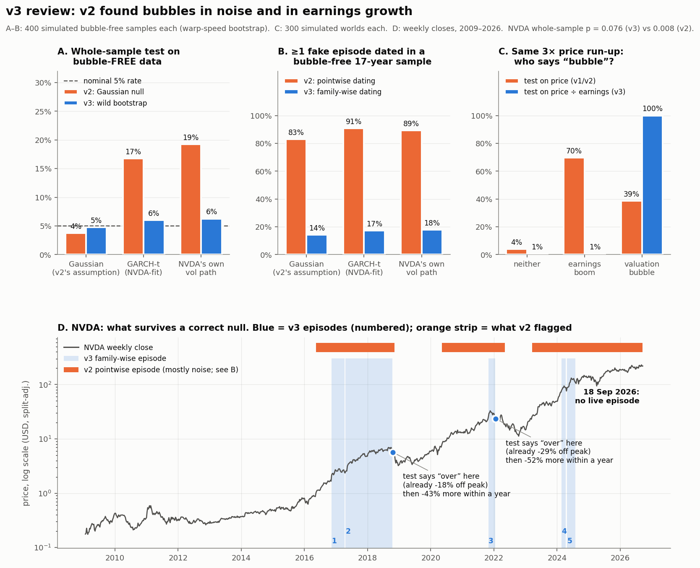

# Results v3

Weekly closes (Stooq, split/dividend-adjusted) through **18 Sep 2026**. Wild-bootstrap nulls,
B = 499, fixed seeds. Reproduce with the commands in the README. Why v2's results were
withdrawn: [`docs/REFEREE_REPORT_v2.md`](../docs/REFEREE_REPORT_v2.md).

## 1. Whole-sample tests: nothing survives

| series | T (weeks) | GSADF | v2 p (Gaussian null) | **v3 p (wild bootstrap)** | v3 BH q | significant at 5% FDR |
|---|---|---|---|---|---|---|
| NVDA | 922 | 2.926 | 0.008 | **0.076** | 0.304 | no |
| SPY | 1,126 | 2.713 | 0.016 | **0.432** | 0.864 | no |
| SMH | 865 | 1.501 | 0.400 | 0.708 | 0.944 | no |
| CRWV | 78 | −0.489 | 0.978 | 0.972 | 0.972 | no |

NVDA robustness: p = 0.088 with B = 999 and a new seed; p = **0.200** if the null keeps NVDA's
~40%/yr drift instead of removing it. None of the conclusions changes. **Under a
volatility-robust null, there is no statistically significant evidence of explosive price
dynamics over the full sample in any of the four series.**

## 2. Local episodes: NVDA has some, and none is live

Family-wise dating (52-week window, ⌈log T⌉ = 7-week minimum). SMH, SPY and CRWV date none.

| # | origination | peak | test says "over" | gain, detection → peak | fall, peak → "over" | weeks from peak to "over" | next 52 wks | worst in next 52 wks |
|---|---|---|---|---|---|---|---|---|
| 1 | 2016-11-11 | 2017-02-03 | 2017-04-14 | +30% | −16% | 10 | +125% | 0% |
| 2 | 2017-04-21 | 2018-09-28 | 2018-10-19 | +178% | −18% | 3 | −18% | **−43%** |
| 3 | 2021-10-29 | 2021-11-19 | 2022-01-21 | +29% | −29% | 9 | −28% | **−52%** |
| 4 | 2024-02-23 | 2024-03-22 | 2024-04-19 | +20% | −19% | 4 | +46% | 0% |
| 5 | 2024-04-26 | 2024-06-14 | 2024-08-09 | +50% | −21% | 8 | +66% | −10% |

**Is five episodes more than noise?** On 400 bubble-free series carrying NVDA's own volatility
path, the procedure dates 0.25 episodes on average; three or more separate clusters appear 1.0%
of the time. NVDA has three clusters (2016–18, 2021–22, 2024). That is evidence (p ≈ 0.01) of
local explosive *price* episodes. The statistic was chosen after seeing the data, so treat it as
exploratory, not confirmatory.

**Window sensitivity** (`window_sensitivity_nvda.csv`): the 2016–18 episode is dated under every
window from 26 to 156 weeks. The 2021–22 and 2024 episodes appear at 26 and 52 weeks only. At
the most permissive window (26), there is also a 2025-10 → 2026-07 episode, now ended. **"No live
episode on 18 Sep 2026" holds at every window.**

## 3. What the episodes say about "when the music stops"

- **Onset is useless for timing a top.** From detection to peak, price rose another 20–178%
  (median +30%). A bet against the detection signal loses.
- **"It's over" arrives late relative to the peak.** When the test declares an episode ended,
  price is already 16–29% off the high, 3–10 weeks after the peak.
- **But in two of five cases it arrived early relative to the trough.** After the 2018 and 2022
  terminations, NVDA fell a further 43% and 52% within a year. After the other three it rallied
  46–125%.

With five episodes that is an anecdote with numbers, not a finding. The useful reframe is the
question: *when a correctly calibrated test says an episode is over, how much is left to fall?*
That is answerable with more series and a pre-registered protocol. Onset timing is not.

## 4. The costs of being right

The wild bootstrap is not free. On planted bubbles (T = 250, 50-week explosive phase, M = 400):

| explosive root ρ | power, Gaussian null | power, wild bootstrap |
|---|---|---|
| 1.02 | 40.0% | 40.0% |
| 1.03 | 62.3% | 59.5% |
| 1.04 | 80.8% | 71.0% |
| 1.06 | 93.2% | 87.0% |

That's up to ten points of power in exchange for a false-positive rate that falls from 17–60%
to about 5%. The wild bootstrap resamples the bubble's own large increments, so the null gets
noisier exactly when a bubble is present. We take the trade.

## 5. What these results do not say

- **They are about price, and price is the wrong object** (referee report R1). NVDA's local
  episodes may be earnings booms. The valuation-ratio test that separates the two is built and
  tested (`src/fundamentals.py`) but has not been run on NVDA: it needs quarterly revenue from
  SEC filings, with filing dates to avoid look-ahead. **That is the decisive next test.**
- "No significant whole-sample evidence" is not evidence of no bubble. With p = 0.076 and
  power of 60–70% against moderate bubbles, the honest summary for NVDA is *inconclusive
  on price alone*.
- Nothing here bears on the circular-funding thesis, which is not yet in the code.
- Not investment advice. Section 3 is the empirical reason why.
