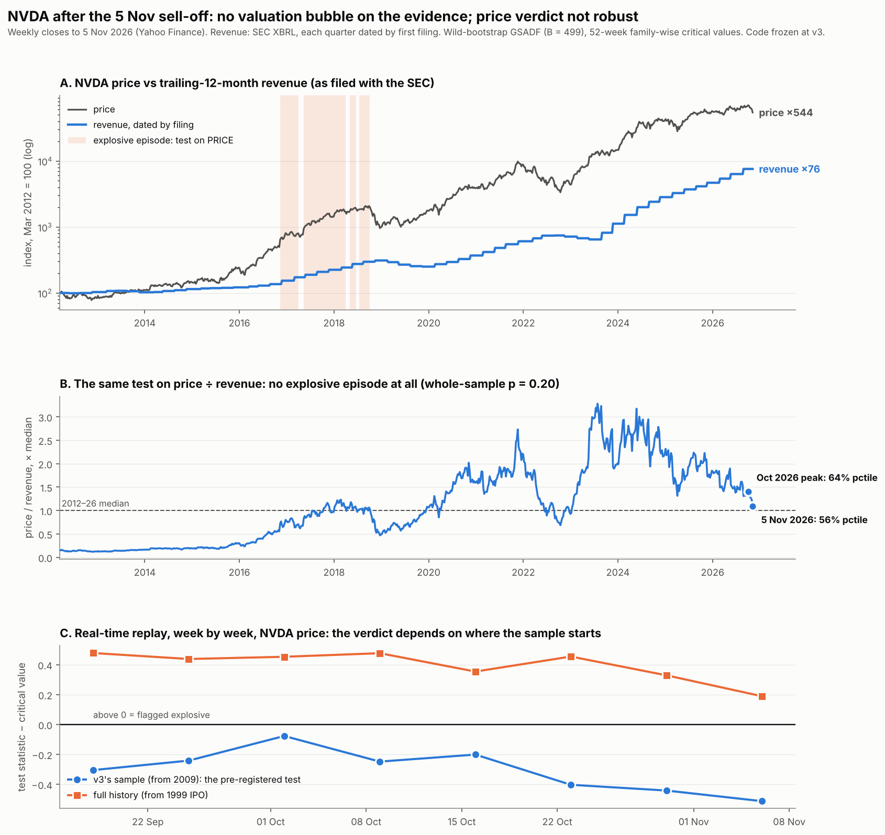

# Update v3.1 — 6 November 2026, the day after the AI sell-off

Weekly closes to **5 Nov 2026** (Yahoo Finance, via `src/fetch_data.py`). Nvidia revenue
from SEC XBRL filings, each quarter dated by its first filing. **Detection code frozen
at v3**: no parameter, threshold or method changed after seeing the new data.



## 1. The pre-registered test: passed

**Prediction, stated in chat before the replay ran:** v3 dates no explosive episode for
NVDA in October 2026; the September–October run-up was not super-exponential.

**Test:** for every week from 18 Sep to 5 Nov, cut the data at that week and run v3 exactly
as it would have run that day, on v3's own sample (from 22 Jan 2009).

| week | NVDA close | statistic − critical value | flagged |
|---|---|---|---|
| 18 Sep | $222.27 | −0.30 | no |
| 25 Sep | $225.07 | −0.24 | no |
| 2 Oct | $233.95 | **−0.08** (closest) | no |
| 9 Oct | $229.28 | −0.25 | no |
| 16 Oct | $214.13 | −0.20 | no |
| 23 Oct | $210.96 | −0.40 | no |
| 30 Oct | $204.64 | −0.44 | no |
| 5 Nov | $181.60 | −0.51 | no |

Never flagged. The 18 Sep run reproduces v3's published whole-sample p = 0.076, confirming
the replay matches the original. **The prediction was correct.** The detector stayed silent
through a 24% fall from the October peak, which is what it is built to do. It looks for
super-exponential rises, not for tops or crashes.

The whole-sample p-value moved between 0.044 and 0.082 over the eight weeks; it dipped
below 0.05 once (30 Oct). With eight looks and no correction that is not a signal.

## 2. The finding that matters more: the price verdict depends on the sample

v3 ran on Stooq data starting in 2009. Yahoo's history goes back to Nvidia's 1999 IPO. On
the **full history**, the same frozen code flags NVDA as explosive in **every** week from
18 Sep to 5 Nov, with an episode live since around April 2026, still flagged after the 9% drop.

| | v3 sample (from 2009) | full history (from 1999) |
|---|---|---|
| NVDA flagged, 18 Sep – 5 Nov | 0 of 8 weeks | **8 of 8 weeks** |
| SMH flagged | 0 of 8 | 7 of 8 (until the 5 Nov drop) |
| SPY flagged | 0 of 8 | 4 of 8 (flickering) |
| **RSP (equal-weight S&P)** | **0 of 8** | **0 of 8** (statistic ≈ 0) |
| CRWV flagged | 0 of 8 | 0 of 8 |

The start date changes the minimum window (about 63 vs 82 weeks) and the volatility path the
bootstrap resamples, and the verdict flips. **"Is Nvidia's price in an explosive episode
right now?" has no robust answer from this test.** We pre-specified the 2009 sample, so the
pre-registered answer is "no", but a reader is entitled to know the other sample says "yes".

The one robust result in this table: the **equal-weight** S&P (RSP) shows nothing on either
sample. Whatever is explosive is concentrated in the largest names, not market-wide.
That's the clean control v2 lacked, and the reason v2's SPY results misled.

## 3. The decisive test: price relative to revenue

Testing price alone cannot tell an earnings boom from a bubble (referee report R1). The
valuation-ratio test, built and simulation-tested in v3, now runs on real data:
log(price ÷ trailing-12-month revenue), weekly, March 2012 – November 2026.

| test, same 2012–26 window | whole-sample p | dated episodes |
|---|---|---|
| on price (control) | 0.068 | 4, all in Nov 2016 – Oct 2018 |
| **on price ÷ revenue** | **0.202** | **none** |

**On the evidence, Nvidia's valuation multiple has had no explosive episode since 2012.**
The 2016–18 price episode disappears once revenue is accounted for. (The 2021–22 and 2024
price episodes are not dated by the price test on this shorter window either, so for
those two the comparison is silent rather than exculpatory.)

What drove each v3 price episode, from detection to peak:

| v3 episode | price | revenue (TTM) | multiple | share of gain from revenue |
|---|---|---|---|---|
| Nov 2016 → Feb 2017 | +30% | +13% | +15% | 46% |
| Apr 2017 → Sep 2018 | +178% | +72% | +62% | 53% |
| Oct → Nov 2021 | +29% | 0% | +29% | — |
| Feb → Mar 2024 | +20% | 0% | +20% | — |
| Apr → Jun 2024 | +50% | +31% | +15% | 66% |

The 2021 and early-2024 episodes lasted 3–4 weeks from detection to peak, too short for a
quarterly revenue figure to update, so their split is uninformative ("—").

Since March 2012: price ×544, revenue ×76, multiple ×7. The multiple rose a lot, but
gradually. It peaked in mid-2023 to 2024 and **has been falling for two years**: revenue has
outgrown the price. At the October 2026 peak, price/sales was at the **64th percentile** of
its own 2012–26 range; after the sell-off it is at the 56th.

## 4. What this does and does not say

**It says:** on the best test available here, Nvidia's run looks like an earnings boom with
a gradually rising multiple, not a valuation bubble. The October 2026 peak was not
extreme relative to revenue.

**It does not say the revenue is real.** This is the project's own thesis, and the test
inherits it rather than answers it. The ratio takes revenue as given. If part of Nvidia's
revenue is financed by Nvidia itself (equity stakes in its customers, the July 2026 backstop
that rents back unused capacity; see `docs/roadmap_addendum_2026-09.md` §2), then the
denominator sits inside the loop, and a bubble in revenue would pass this test untouched.
**The valuation test moves the bubble question from the price to the revenue.** The
circular-funding ratio is the instrument for that question, and it is now clearly the most
important unbuilt piece of the project.

Two further limits:

- **Trailing revenue is backward-looking.** This week's shock is about *future* revenue (UBS:
  ~30% of expected 2028 US data-center additions at risk). A TTM ratio cannot see it until
  it shows up in filings, a year or more from now.
- **Absence of evidence.** p = 0.20 on 765 weeks is "no detectable explosive episode", not
  proof that none exists. Power against moderate bubbles is 60–70% (v3 results §4).

Nothing here is investment advice.

## 5. Data provenance

- **Prices:** Yahoo Finance. NVDA and CRWV match the Stooq data v3 used exactly on the overlap;
  SMH and SPY differ slightly (dividend-adjustment conventions). RSP is new.
- **Revenue:** SEC XBRL `us-gaap:Revenues`, quarters dated by first filing (filing lags 18–47
  days; asserted). Fiscal Q4 is derived as annual minus Q1–Q3 and dated by the 10-K. FY2019–21
  annual totals were originally filed under the ASC 606 tag; their values and first-filing
  dates are hard-coded with provenance in `src/nvda_valuation.py` and verified automatically
  against `data/nvda_revenue_asc606.json` once `fetch_data.py` has downloaded it. Trailing
  revenue matches all eight 10-K annual totals checked, to the dollar. The series starts in
  fiscal 2012 because earlier quarters exist under this tag only as late comparatives.
- **Ratio:** split-adjusted price ÷ total revenue (price/sales up to share count, which has
  drifted ~10% since 2009, far too slowly to create or hide an explosive root).

## Reproduce

```bash
python src/fetch_data.py --sec-contact "Your Name you@example.com"
python src/oos_realtime.py                    # pre-registered replay  -> results/oos_realtime.csv
FULL_HISTORY=1 python src/oos_realtime.py     # full-history replay    -> results/oos_realtime_fullhistory.csv
python src/nvda_valuation.py                  # ratio test, same-window price control,
                                              # episode decomposition -> results/nvda_*
python src/make_figure_v31.py                 # -> results/v31_nov2026.png
```
